<div align="center">

# 简行 Jianxing

**基于多智能体的银行业务与深度研究系统**

一句话提出多项需求，按条件分步办理，让分析、确认与回执连成一条流程。

OpenAI Agents SDK · LangGraph · ChromaDB · FastAPI

[快速启动](#快速启动) · [架构](#系统架构) · [功能展示](#真实功能展示) · [15页介绍](#十五页项目介绍) · [评测](#评测与验证) · [交付下载](https://github.com/xqcd77/jianxing/releases/tag/submission-2026.10.29)

</div>

简行针对手机银行入口分散、组合业务步骤长、金融分析缺少依据的问题，提供**直接办理＋Deep Research**两条路径，在合成金融沙箱覆盖**6类场景、31项主菜单入口**。明确操作组织为可核对的计划，复杂问题先取证比较；用户选择方案后，再进入确认、授权和办理。

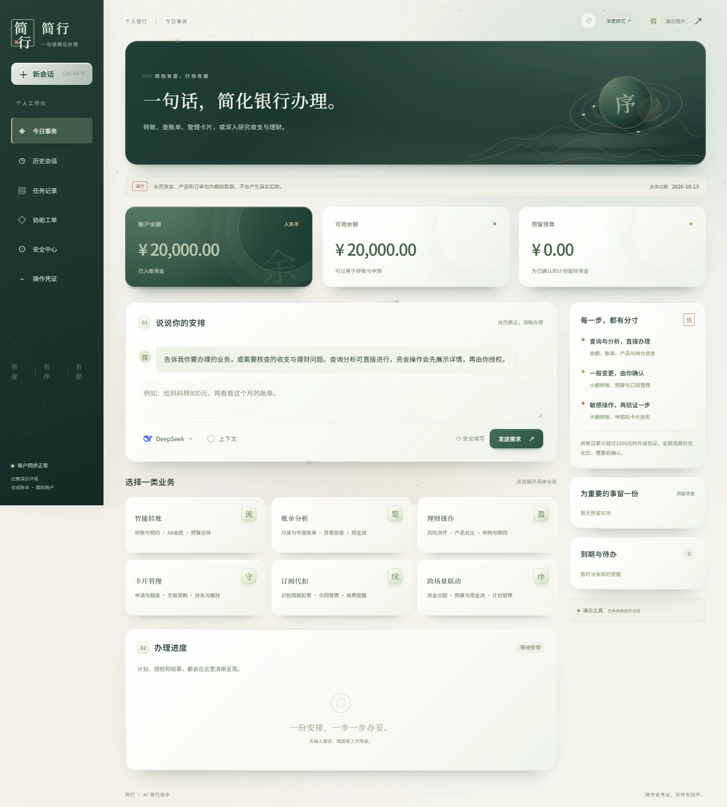

> 账户、资金、产品和验证码均为演示数据，不连接真实银行扣款。ETF公开资料查询不等于证券购买或自动定投，商户会员新开通也不在当前执行范围内。

## 从一句话到办理结果

例如：“给妈妈转400元，给小王转1500元，剩下的钱的20%做理财并给出建议。”

1. 保存三项目标，分别记录收款人、金额、依赖和待补条件，防止只回答最后一项。
2. 假设当前可用4500元，程序计算理财研究预算为(4500−400−1500)×20%=520元。
3. 两笔转账分别展示核对与授权入口，研究目标读取真实资金约束和产品资料。有依赖的步骤等待前置条件，独立步骤分别推进。
4. 研究报告给出依据与未知项，选品后重新核验测评及当前资金。已完成步骤保留回执，续问或改金额不会重新付款。

这是处理规则说明；实际是否已办理，以本人授权和沙箱账本回执为准。

## 能力范围

| 场景 | 主要功能 | 关键边界 |
| --- | --- | --- |
| 智能转账 | 联系人转账、预约、AA收款、预留和资金分配 | 大额分级验证；余额与限额执行前重查 |
| 账单分析 | 月报年报、退款口径、收支核查和现金流研究 | 保留统计期间、查询来源和可用资金口径 |
| 理财操作 | 模拟产品比较、测评、申购和赎回 | 不代填风险测评，不把未到账赎回当现金 |
| 卡片管理 | 申请、限额、类别限制、挂失与解挂 | 卡片共用关联账户，不是独立充值钱包 |
| 订阅代扣 | 已有订阅查询、提醒、停扣与合同处理 | 停扣不等于解约或退款；不冒充已开新会员 |
| 跨场景联动 | 组合目标、DAG依赖、预算重算和综合研究 | 受阻目标保留条件；未知提交先查询 |

31项指主菜单入口，不等于31个独立Agent或31种底层工具。以界面入口及服务端能力注册表为准。

## 对应比赛评分的设计

| 评分方向 | 具体做法 | 怎么验收 |
| --- | --- | --- |
| 任务完成 40% | 全目标清单、DAG依赖、确定性金额计算、按需工具和逐项回执 | 不漏目标、不错绑金额、有据可查；按状态和账本核对实际完成 |
| 安全合规 30% | 所有权检查、分级授权、参数版本绑定、凭证保护与不可信证据隔离 | 诱导话术不能授权；越权、信息套取和注入不能改写执行权限 |
| 创新与交互 30% | 直接办理连接研究决策、口语输入与缺项追问、历史续办、停止与异常恢复 | 已填复用，条件缺失有入口，超范围给出明确边界，不伪造成功 |

此表说明设计与证据，不代表大赛已评分。详见[测试说明](docs/testing.md)、[安全设计](docs/security-design.md)和[自评风险](docs/known-risks.md)。

## 系统架构

**1个Supervisor＋4个子Agent**：账单研究、理财研究、业务办理、独立核验。

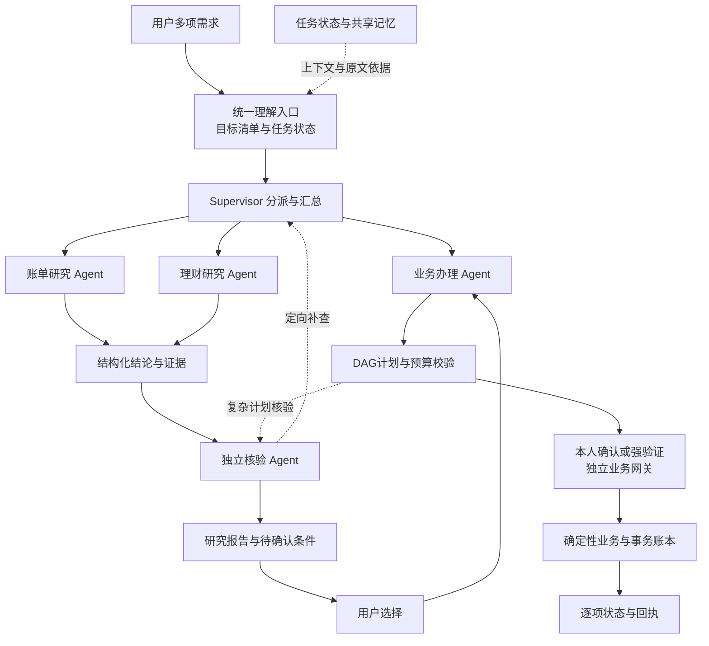

| 组件 | 负责什么 |
| --- | --- |
| LangGraph | 任务流转、条件路由、检查点和有界恢复 |
| Agents SDK | 结构化角色调用，输入输出由Pydantic约束 |
| Harness | 完整请求预算、期限、运行事件、取消和指标 |
| ChromaDB | 带权限过滤的记忆检索索引，可重建 |
| SQLite | 任务状态、原文、授权、账本、回执和检查点 |
| 业务网关 | 核对本人资源、参数、风险、资金和本次授权后执行 |

任务状态直接读取持久记录；历史记忆走“Embedding检索 → TextRank提取 → 原文回读”。TaskBrief交接、RoleReturn返回协议、角色化上下文与阶段去重减少重复输入；版本冲突规则及后台整理保留关键约束。历史余额和研究结论不能替代当前银行事实与交易授权。

[详细架构](docs/architecture.md) · [算法说明](docs/algorithms.md) · [权限分级](docs/permissions.md)

<details>
<summary>查看作者完成的系统架构海报</summary>

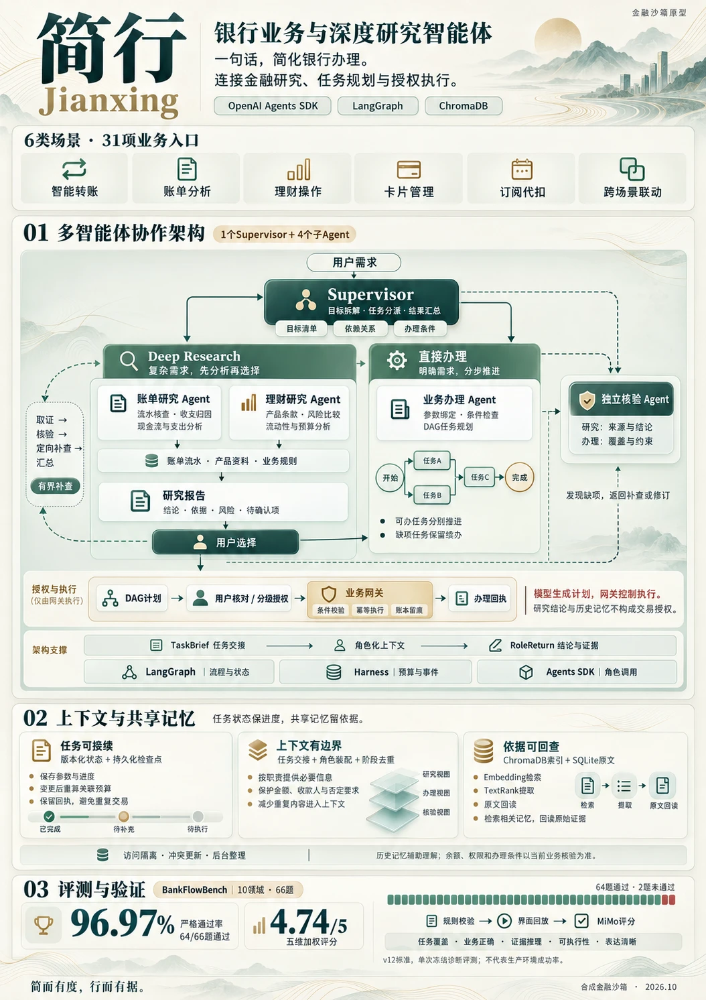

</details>

## 真实功能展示

以下截图来自实际本地界面，使用隔离合成数据；部分研究资料为固定夹具。截图展示某一时刻，不表示实时金融数据或所有任务已执行。

<details>
<summary>查看登录界面</summary>


</details>

### 多目标办理与任务进度


每项需求单独保留状态、缺项和下一步。独立任务分别推进，完成回执随任务保存。

### Deep Research报告

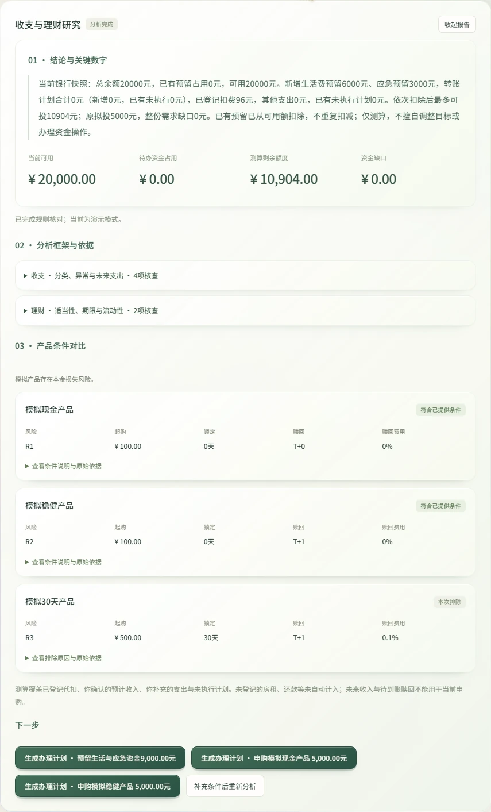

报告区分资金结论、风险及流动性条件、比较依据与未知项。选择方案后进入办理，报告本身不授权。

### 大额确认与风险测评

| 本次操作核对 | 风险测评入口 |
| --- | --- |
| 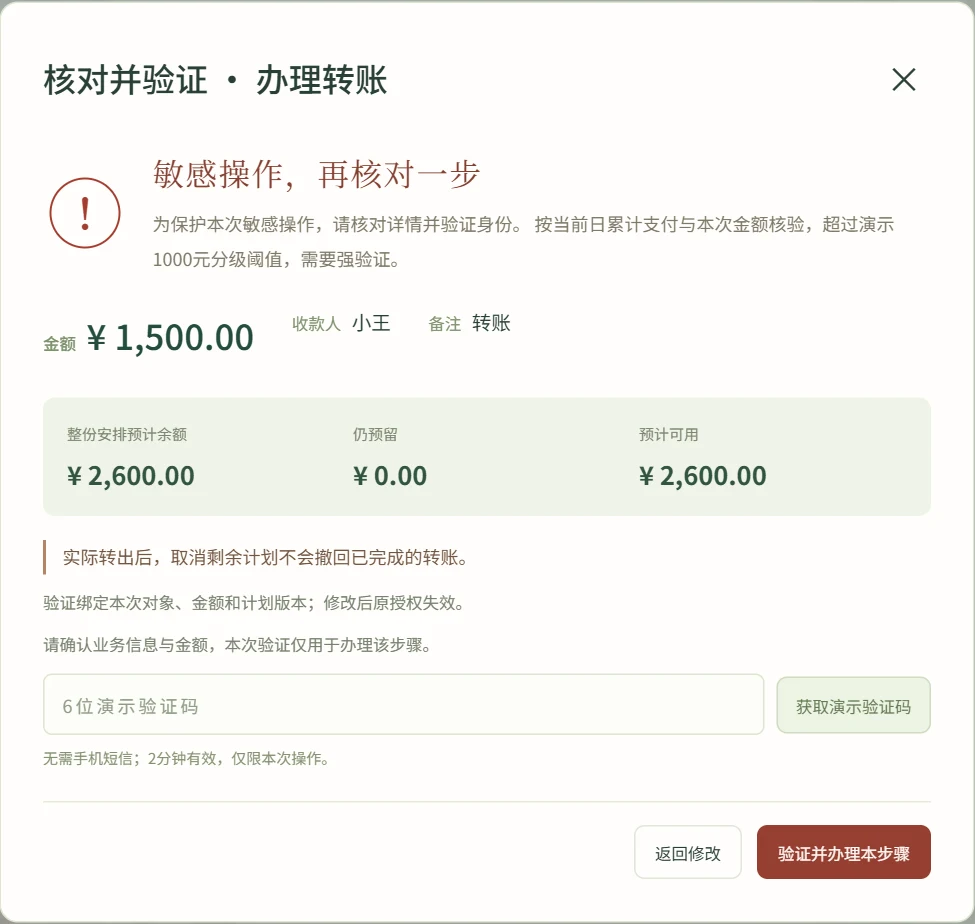 |  |

### 六类业务入口

| 账单分析 | 模拟理财 |
| --- | --- |
|  |  |

| 卡片管理 | 订阅代扣 |
| --- | --- |
|  |  |

### 历史会话与上下文

| 历史续办 | 上下文容量 |
| --- | --- |
|  | 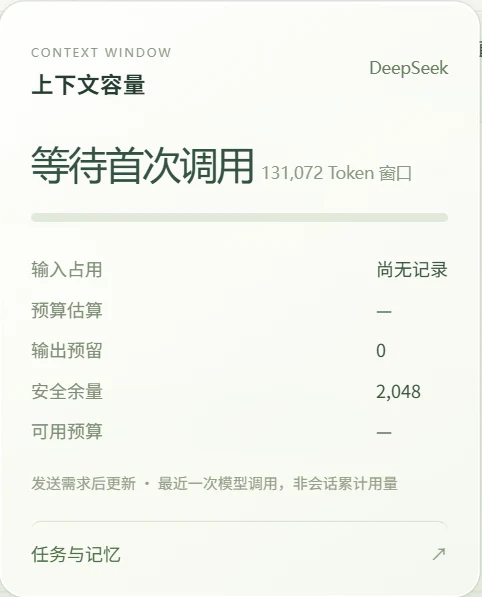 |

### 用户自选模型

| 模型选择 | Key与具体模型配置 |
| --- | --- |
| 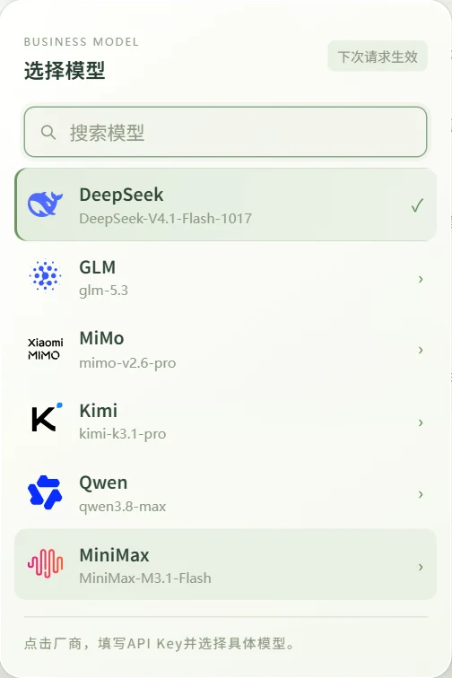 | 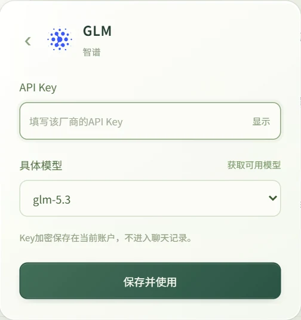 |

支持DeepSeek、GLM、MiMo、Kimi、Qwen、MiniMax。用户自行填写Key并选择具体模型，Key保存在服务端加密存储，切换对下一次请求生效。型号预设可编辑，可用性及费用以厂商账户为准。

## 评测与验证

**BankFlowBench 10领域66题，2026-10-28冻结当前架构，MiMo v12。**

| 指标 | 结果 |
| --- | ---: |
| 严格按预期处理 | **64/66，96.97%** |
| 五维加权分 | **4.7431/5** |
| 执行类实际办结 | **17/22，77.27%** |
| 状态断言 / 有效语义评分 | 66/66 / 66/66 |
| 资金与授权不变量违规 | 本次未观察到 |
| 有效失败 / 未决 | 2 / 0 |

严格通过包含正确拒绝和条件解释，**不能将96.97%写成交易办结率**。22个执行任务中3个条件不符、2个能力缺口没有完成交易。五维权重为任务覆盖2、业务正确性2、证据推理1、可执行性1、表达清晰度1，N/A不补满分，与大赛40/30/30分项不混算。

保留两项失败：基金续问的分项条款回应不完整；会员按月付条件已保存但未明确展示。题集参与开发、每题单次执行，本轮未重跑Single-Agent；不把旧版本提升数字用于当前结果，也不表示生产可靠性。

[结果与口径](docs/evaluation.md) · [冻结逐题记录](evaluation/published/bankflow_lite66_20261028/) · [测试及复现](docs/testing.md)

## 快速启动

Python 3.12或以上。规则演示无需模型Key，适合体验确定性业务与UI；开放式自然语言需配置真实模型。

```powershell
git clone https://github.com/xqcd77/jianxing.git
cd jianxing
python -m venv .venv
.venv\Scripts\python.exe -m pip install -e ".[dev]"
Copy-Item .env.example .env
.\start.ps1
```

打开http://127.0.0.1:8000。演示账户demo、wang、li，密码均为DemoBank!2026。初始主账户余额为0，可用演示工具模拟入金。本机地址需先启动服务，不能当公网体验链接。

真实模型在.env设置BANK_MODEL_MODE=llm并配置自己的Key，或在模型选择器配置。语义Embedding需准备BGE缓存，默认lexical模式不等于语义检索效果。具体步骤、Docker及常见问题见[部署说明](docs/deployment.md)。默认本地运行，不输入真实金融凭证。

## 十五页项目介绍

下面15张图全部由最终可编辑PPT导出，按答辩顺序分组。展开即可逐页阅读，原始PPT与PDF可在[交付版本](https://github.com/xqcd77/jianxing/releases/tag/submission-2026.10.29)下载。

<details>
<summary>01—03 项目定位、用户问题与系统架构</summary>


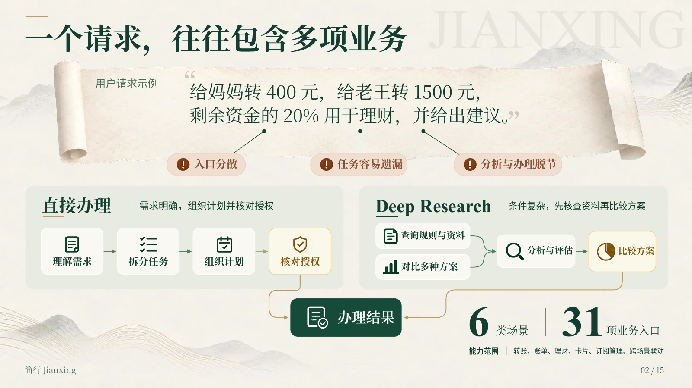

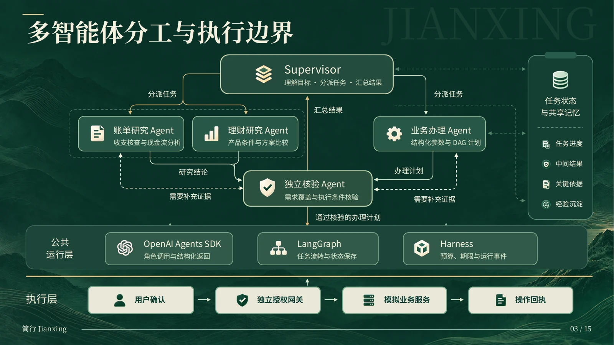

</details>

<details>
<summary>04—06 多目标规划、深度研究与共享记忆</summary>

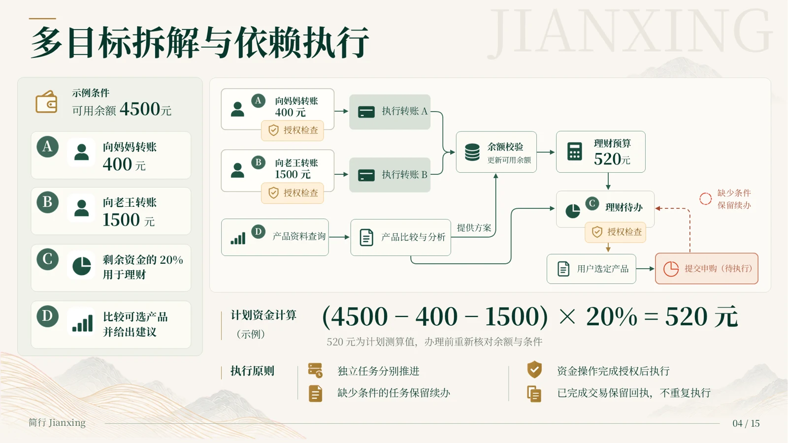

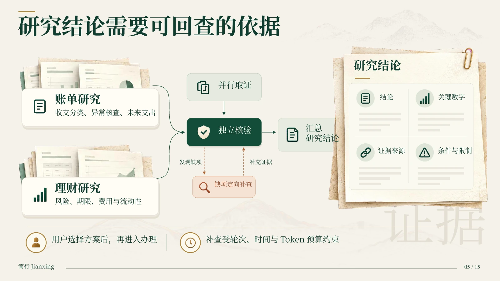

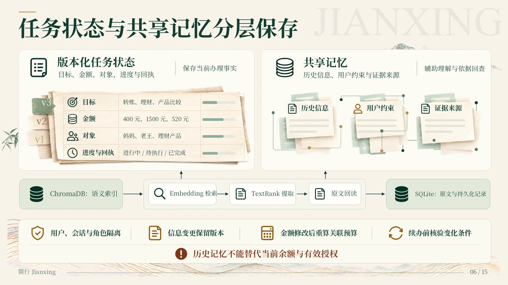

</details>

<details>
<summary>07—09 上下文、安全授权与工作台</summary>

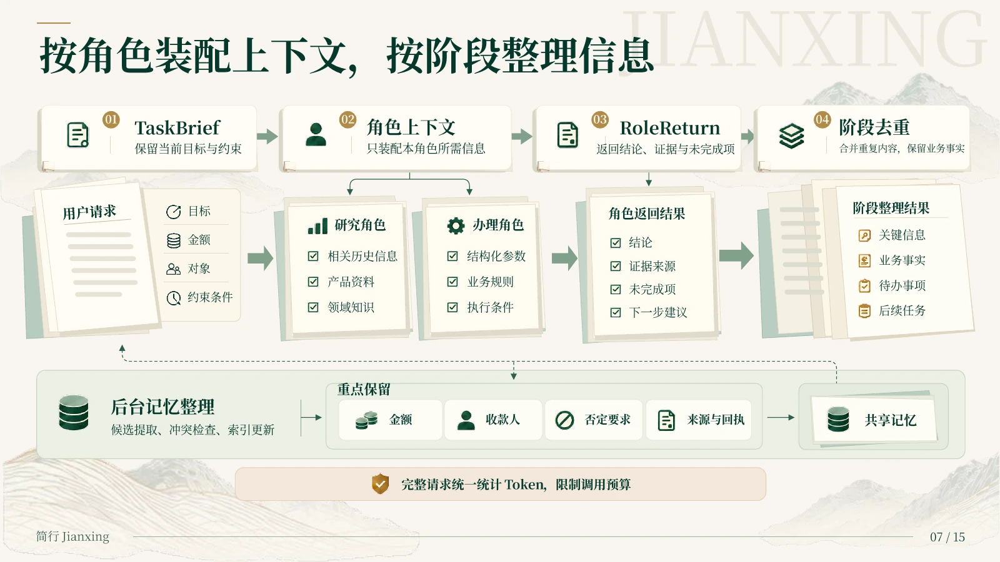

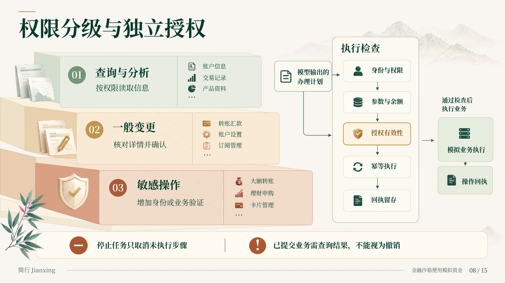

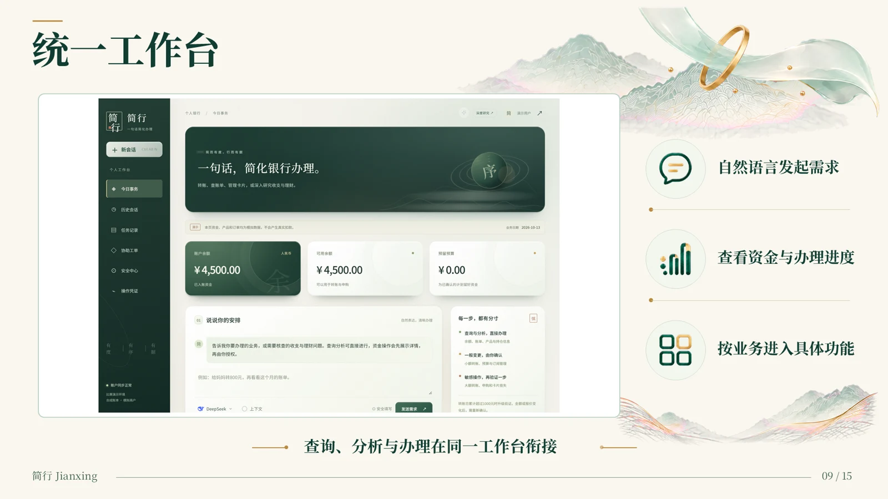

</details>

<details>
<summary>10—12 组合办理、研究报告与验证入口</summary>

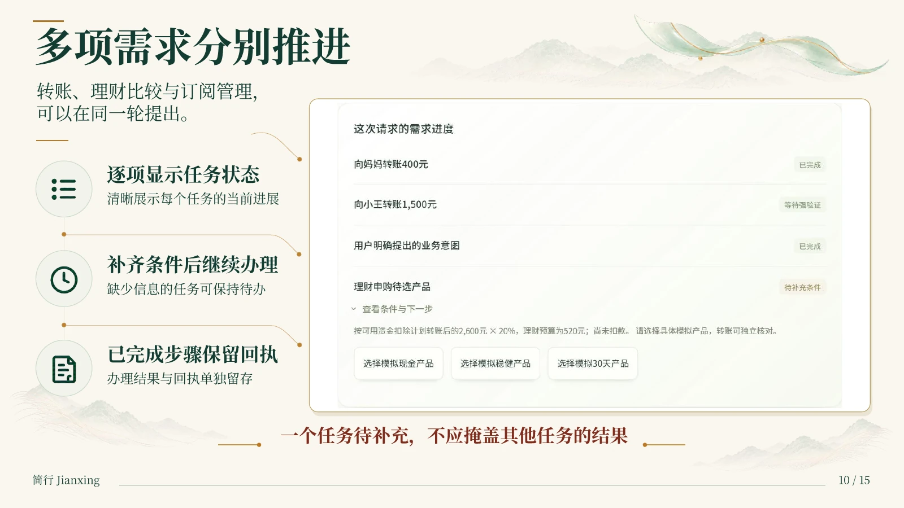

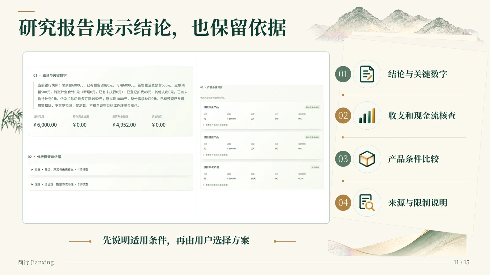

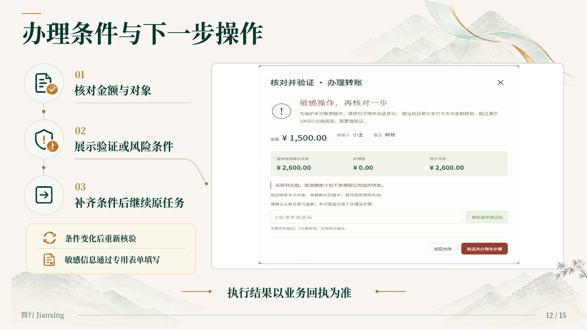

</details>

<details>
<summary>13—15 会话与模型、评测标准与交付结果</summary>

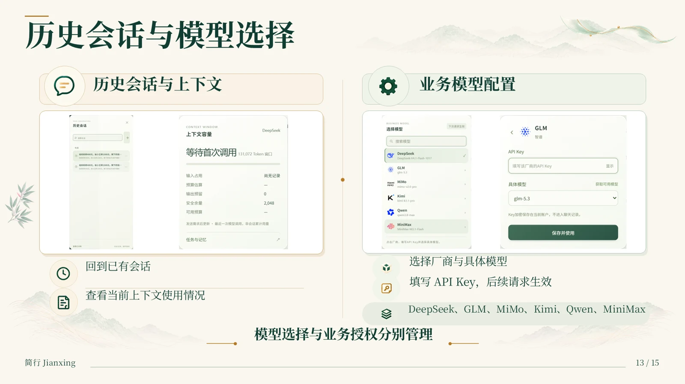

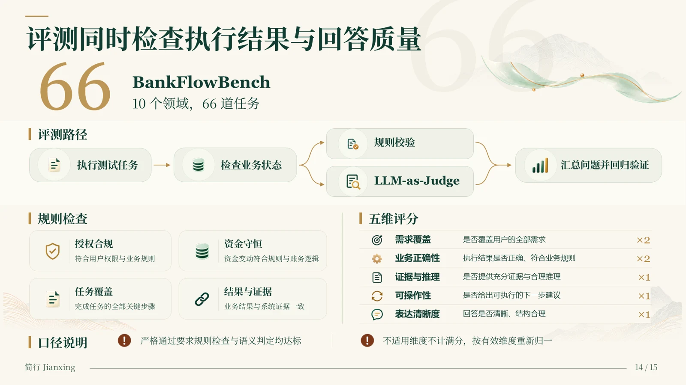

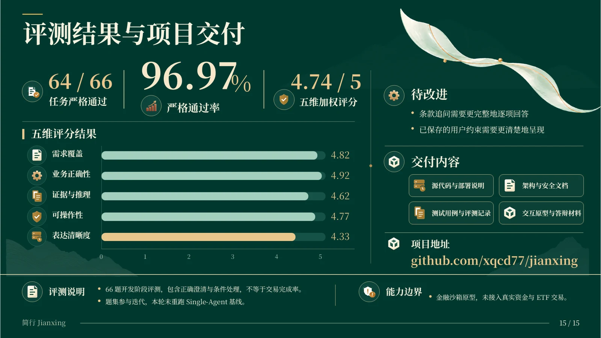

</details>


## 交付材料

四个主文件夹分别对应必交要求，没有旧版PPT或中间汇总表。

```text
简行_参赛交付材料/
├─01_技术文档/
│  ├─01_架构图_POSTER/              作者提供的最终海报
│  ├─02_算法说明/                   算法说明PDF
│  └─03_安全设计/                   安全设计PDF
├─02_答辩PPT/                        15页可编辑PPT与PDF预览
├─03_源代码/                         完整仓库快照
│  ├─README.md与仓库地址.txt
│  ├─docs/deployment.md              部署说明
│  ├─docs/testing.md                 测试说明
│  ├─tests/                         自动化测试用例
│  └─evaluation/                    题集与冻结评分记录
└─04_安全自评/
   ├─01_权限分级说明/               实现说明与核查证据
   └─02_已知风险清单/               剩余风险及处理建议
```

[下载完整交付包](https://github.com/xqcd77/jianxing/releases/tag/submission-2026.10.29) · [完整文档](docs/README.md) · [9分30秒演示安排](docs/demo.md)

## 代码目录

```text
bank_agent/     Agent 流程 业务网关 记忆与网页
tests/          自动化回归用例
evaluation/     当前66题 继承题集 评测器与冻结记录
scripts/        评测 运行准备和界面验证工具
docs/           架构 算法 部署 安全 自评与展示图片
docker/         可选容器辅助
.github/        持续集成检查
```

评测器仍依赖48题、58题等继承数据及历史基线，保留这些文件是为了复算与回归。旧开发笔记、重复截图、已替换的海报和10页答辩已从当前版本移除。源码供作品评审，字体与厂标按各自许可使用；本项目未额外授予开源许可。已知安全边界见[风险清单](docs/known-risks.md)。
