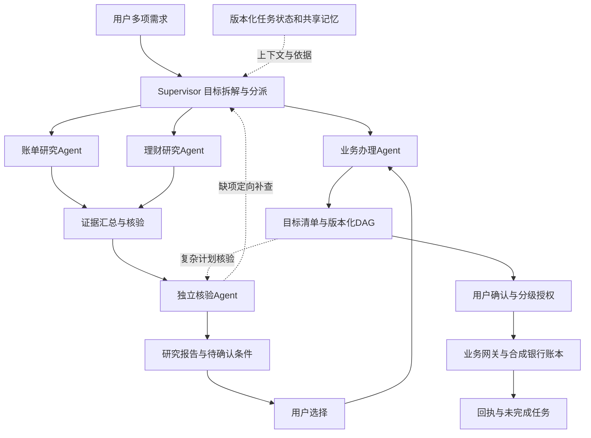
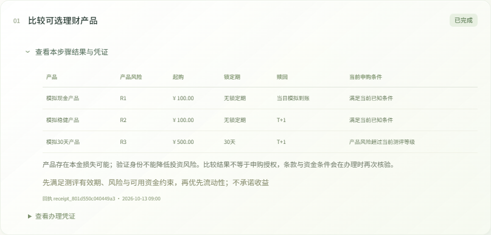
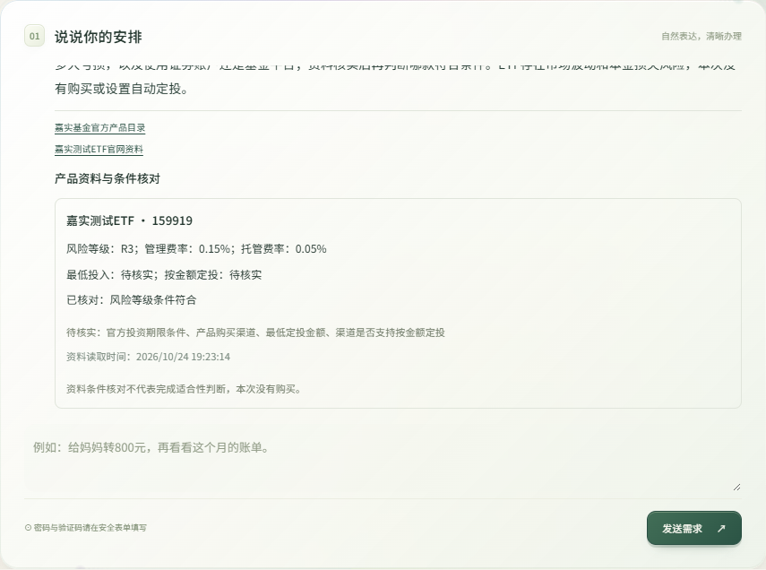

<div align="center">

# 简行 Jianxing

**基于多智能体的银行业务与深度研究系统**

OpenAI Agents SDK · LangGraph · ChromaDB · FastAPI

[快速启动](#快速启动) · [功能展示](#功能展示) · [架构与算法](#架构与算法) · [评测结果](#评测结果) · [完整文档](docs/README.md)

</div>

简行让用户用一句话提出多项银行需求，分别查看每项任务的条件、授权与回执。明确需求直接办理，复杂需求先研究再选择，覆盖 **6类场景、31项主菜单入口**。

> 本项目仅连接合成金融沙箱。账户、资金、产品、订单和验证码均用于演示，不产生真实银行扣款。


## 可以做什么

| 场景 | 示例与处理边界 |
| --- | --- |
| 智能转账 | 联系人转账、预约、AA收款、预算预留，资金操作逐项授权 |
| 账单分析 | 月报、年报、退款口径与现金流分析，保留数据期间和来源 |
| 理财操作 | 模拟产品比较、风险测评、申购和赎回，重新核验适当性 |
| 卡片管理 | 申请、限额、类别限制、挂失与解挂，卡片共用关联账户 |
| 订阅代扣 | 查询、提醒、停扣与合同处理，停扣不等于解约或退款 |
| 跨场景联动 | 组合目标、DAG依赖和综合研究，保留每项目标与待补条件 |

ETF资料查询不等于证券交易，本原型未接入ETF购买及自动定投，也未接入商户会员新开通。

## 快速启动

需要Python 3.12或以上。规则演示模式无需模型Key。

```powershell
git clone https://github.com/xqcd77/jianxing.git
cd jianxing
python -m venv .venv
.venv\Scripts\python.exe -m pip install -e ".[dev]"
Copy-Item .env.example .env
.\start.ps1
```

打开 **http://127.0.0.1:8000**。演示账户为`demo`、`wang`、`li`，密码均为`DemoBank!2026`。初始主账户余额为0，可在演示工具中模拟工资到账。这个地址只在启动服务的电脑上有效。

规则演示用于复现UI与确定性业务，开放式自然语言需要配置真实模型。在.env中设置`BANK_MODEL_MODE=llm`及自己的模型Key，或在模型选择器为相应厂商配置Key和模型。DeepSeek、GLM、MiMo、Kimi、Qwen、MiniMax的可用性以厂商账户为准。[完整部署说明](docs/submission/deployment.md)

## 架构与算法

**1个Supervisor与4个子Agent**：账单研究、理财研究、业务办理、独立核验。六类业务菜单及规则服务不计入Agent数量。



LangGraph控制任务流与检查点，Agents SDK执行结构化角色调用，Harness管理预算与事件。模型只提交草案，实际资金执行由授权网关控制。

任务状态保存参数和进度，ChromaDB检索历史记忆，SQLite保留原文和正式业务数据。`Embedding检索 → TextRank提取 → 原文回读`减少冗余并保留证据。角色化上下文、结构化去重、版本冲突规则和后台整理支持多轮续办。[核心算法说明](docs/submission/core-algorithms.md)

## 功能展示

以下是本项目实际沙箱界面，部分截图使用规则演示和固定资料夹具，不表示实时行情或真实投资推荐。动态效果仅显示截图时的一帧。

| 登录 | 多目标办理 |
| --- | --- |
|  |  |

| 大额验证 | 风险测评 |
| --- | --- |
|  |  |


| 账单 | 理财 |
| --- | --- |
|  |  |

| 卡片 | 订阅 |
| --- | --- |
|  |  |

| 任务依赖 | ETF资料 |
| --- | --- |
|  |  |

历史会话、记忆管理、上下文容量和用户模型配置已接入当前代码。公开步骤展示实际运行阶段，支持停止尚未提交的任务，已提交业务需查询回执。

## 评测结果

最新冻结诊断：**2026-10-28，BankFlowBench 10领域66题，MiMo v12**。

| 指标 | 结果 |
| --- | ---: |
| 严格通过 | **64/66，96.97%** |
| 五维加权分 | **4.7431/5** |
| 业务状态断言 | 66/66 |
| 有效语义评分 | 66/66 |
| 失败与未决 | 2题失败，0题未决 |

严格通过同时要求状态、资金、授权和全部必需语义项满足。权重为任务覆盖2、业务正确性2、证据推理1、可执行性1、表达清晰度1，N/A不补满分。

两项失败保留：基金续问的分项条款回应不足；会员按月付条件已保存但未完整呈现。本轮没有重跑Single-Agent，不提供同版本对照提升结论。题集参与开发，单次成绩不代表盲测或生产可靠性。[完整结果与测量边界](docs/lite66-repair-results-2026-10-27.md)

## 测试与复现

```powershell
.venv\Scripts\python.exe -m pytest
.venv\Scripts\python.exe -m ruff check bank_agent evaluation tests
npm ci --ignore-scripts
npm run typecheck
```

真实模型评测会消耗业务模型及裁判额度，运行方法见[测试说明](docs/submission/testing.md)。`tests/`提供自动化用例，`evaluation/cases/bankflow_lite66/`提供66题任务与隔离金标。密钥、账户数据库和运行缓存不在仓库中。

## 安全与交付

[安全设计](docs/submission/security-design.md) · [安全自评与风险清单](docs/submission/security-self-assessment.md) · [答辩演示](docs/submission/demo-guide.md)

默认仅本机运行。GREEN、YELLOW、RED分别对应允许自动执行、用户确认、强验证；任何角色都不能用文字绕过授权。演示身份与验证码不能用于生产，真实银行接入需独立安全和合规审查。

```text
bank_agent/                 应用、Agent、规则、记忆及网页
tests/                      离线测试
evaluation/                 评测控制器与题集
scripts/                    运行、评测和检查脚本
docs/submission/            本次交付的清晰版说明
docs/submission/assets/     海报、答辩与上传版文档
compose.yaml                可选容器部署
.env.example                无密钥配置模板
```

原私有源码仓库迁移至本仓库，早期评测记录只作历史参考。源代码公开供作品审阅，第三方字体和厂标按各自许可证使用；本次未擅自追加开源授权条款。
