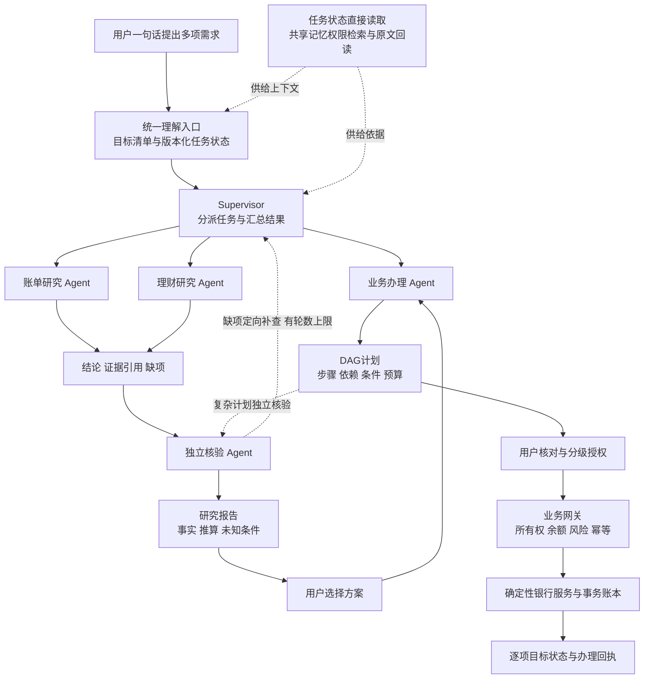

# 简行系统架构

简行将用户一句话中的多项银行需求保存为目标清单，再分别进入直接办理或深度研究。系统由1个Supervisor和4个子Agent组成，真实执行权始终保留在服务端业务网关。所有账户和交易均为合成金融沙箱数据。

## 1 总体流程

研究核验和复杂计划核验使用同一个独立核验角色，但检查对象不同。简单查询不会强制调用全部Agent。独立步骤分别推进；有资金、先后或整单条件的步骤必须等待对应依赖，不能用“并行”绕过业务顺序。

## 2 组件分别负责什么

| 层级 | 组件 | 职责 |
| --- | --- | --- |
| 交互 | 网页工作台与FastAPI | 登录、对话、任务卡片、授权、回执、研究报告、历史与模型配置 |
| 协调 | Supervisor | 保留全部目标，选择处理路径，分派、补查和汇总 |
| 专业角色 | 账单研究与理财研究 | 分别核查流水、资金约束和产品条款，只读取证 |
| 专业角色 | 业务办理与独立核验 | 生成结构化草案，核验需求覆盖、证据与关键约束 |
| 流程 | LangGraph | 节点和条件路由、持久化检查点、等待输入、有界恢复 |
| 模型 | OpenAI Agents SDK | 按角色执行结构化模型调用，返回经过Schema约束的结果 |
| 运行 | 统一Harness | 请求期限、完整请求Token预算、运行事件、取消传播和指标 |
| 记忆 | ChromaDB与SQLite | 前者做可重建检索索引；后者保留原文、任务状态、授权、账本和回执 |
| 执行 | 确定性服务与授权网关 | 核对本人资源、条件与授权，事务提交，返回真实沙箱回执 |

Agents SDK、LangGraph与Harness的职责不同：分别负责角色调用、流程推进和运行约束。六类业务菜单和底层规则服务不计入Agent数量。Single-Agent对照与兼容路径只在指定配置和测试中使用，默认界面采用上述5个角色。

## 3 直接办理怎样完成

用户输入 → 目标与参数识别 → 实时事实查询 → 目标对应DAG → 条件及依赖校验 → 本人确认或强验证 → 网关提交 → 回执更新。目标缺条件时保留已填信息，仅追问缺项。已完成步骤不因续问或重规划再次付款。

例：4500元中向妈妈转400元、向小王转1500元，并研究余款20%的理财安排。系统应保留3个目标，研究预算为520元；两笔转账按各自授权推进，研究建议不代替用户选品或授权申购。

## 4 Deep Research怎样衔接办理

研究请求 → TaskBrief任务交接 → 两类研究按需并行取证 → RoleReturn返回结论、证据和缺项 → 独立核验 → 定向补查 → 汇总报告。报告明确区分已核实事实、计算结果和未知条款。用户选择后进入新的办理草案，当前余额、风险测评及本次授权重新核验。

## 5 关键实现位置

| 能力 | 主要文件 |
| --- | --- |
| 统一需求入口与多目标 | bank_agent/intake.py、request_understanding.py、request_goals.py、goal_state.py |
| 角色与业务编排 | supervisor.py、supervisor_agents.py、supervisor_banking.py、supervisor_research.py、graph.py |
| 结构化交接与上下文 | context_builder.py、role_returns.py、stage_context.py |
| 记忆与整理 | memory.py、memory_index.py、memory_policy.py、memory_curator.py |
| 网关与授权 | engine.py、bank_rules.py、preflight.py、security.py、operations.py、services/ |
| 预算和异步任务 | harness.py、token_budget.py、chat_tasks.py、worker.py |

更多计算与状态规则见[算法说明](algorithms.md)，权限与攻击防御见[安全设计](security-design.md)。
